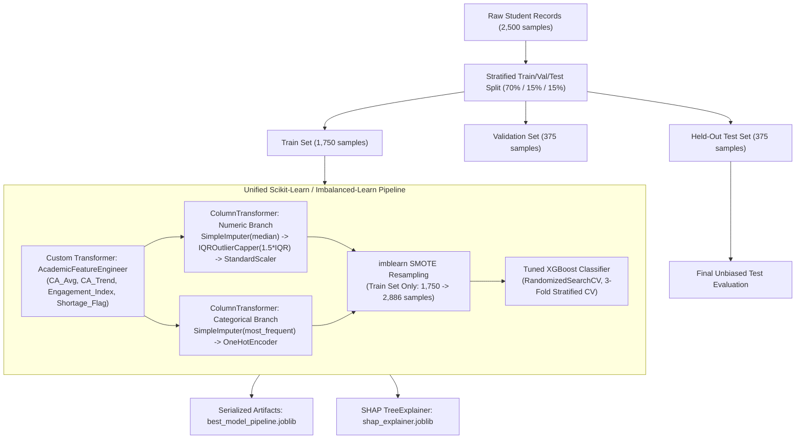

# LPU Student Academic Early-Warning & Intervention System
### Course: INT395 Supervised Learning | Lovely Professional University (LPU)


---

## 1. Executive Summary & Problem Formulation

In contemporary tertiary education systems like **Lovely Professional University (LPU)**, early detection of academic vulnerability is essential to prevent course failure, student debarment due to attendance shortages, and long-term degree attrition. Traditional institutional interventions typically occur **post-facto**—only after End-Term examinations when it is too late to rescue a student's semester GPA.

The **LPU Student Academic Early-Warning & Intervention System** transforms this paradigm by deploying an end-to-end Supervised Machine Learning surveillance framework. By processing real-time academic telemetry across continuous assessments (CA1, CA2, CA3), mid-term examinations, digital LMS portal engagement, assignment completion rates, class participation, and attendance compliance, the system:
1. Predicts individual student risk level (`Low`, `Medium`, `High`) with **78.6% High-Risk Recall** and **0.946 ROC-AUC (OVR)**.
2. Demystifies model decisions using **SHAP (SHapley Additive exPlanations) TreeExplainer** to highlight the exact academic deficiencies elevating student risk.
3. Automatically triggers **prioritized, rule-based Faculty & Mentor Action Plans** compliant with university regulatory codes (e.g., LPU Academic Regulations Section 14.1 Attendance Policy, Remedial Peer-Tutoring Cell, and Academic Probation Advising).

---

## 2. Strictly Flat Enterprise UI/UX Design System

In compliance with strict modern enterprise design guidelines (modeled after Linear, Stripe, and modern institutional dashboards), the frontend is built using **Streamlit** and configured via `.streamlit/config.toml` and custom CSS with:
- **Zero Gradients & Zero Glassmorphism**: No glossy gradients, neon text, or blurry glass surfaces.
- **Solid Color Palette**:
  - Surface & Cards: `#FFFFFF` with `1px solid #E2E8F0` borders.
  - Background: `#F8FAFC`
  - Primary Typography: `#0F172A` (Inter / system-ui sans-serif)
  - Secondary Typography: `#475569`
  - Primary Institutional Accent: Deep Navy `#1E3A8A`
  - Flat Semantic Badges:
    - **High Risk**: `#DC2626` text, `#FEF2F2` background, `#FCA5A5` border
    - **Medium Risk**: `#D97706` text, `#FFFBEB` background, `#FCD34D` border
    - **Low Risk**: `#16A34A` text, `#F0FDF4` background, `#86EFAC` border
- **Interactive Plotly Charts**: White backgrounds (`#FFFFFF`), solid color markers, zero drop-shadows, and crisp `#F1F5F9` gridlines.

---

## 3. Repository Architecture

```
ACADEMIC EARLY-WARNING & INTERVENTION SYSTEM/
├── .streamlit/
│   └── config.toml               # Streamlit enterprise theme settings
├── Application Outcome Images/   # High-resolution dashboard outcome screenshots
│   ├── Executive Overview.png
│   ├── Student Risk & SHAP Profiler.png
│   └── Model Performance &EDA Lab.png
├── artifacts/                    # Pre-computed models & evaluation metrics
│   ├── best_model_pipeline.joblib# Serialized winning Tuned XGBoost Pipeline
│   ├── shap_explainer.joblib     # Serialized TreeExplainer SHAP artifact
│   ├── feature_names.json        # Processed feature names list
│   ├── eda_stats.json            # Pre-calculated dataset summary statistics
│   ├── model_comparison.json     # 6-way benchmark metrics (Baseline vs Ensembles)
│   ├── confusion_matrix.json     # Normalized and raw confusion matrix
│   ├── roc_curves.json           # One-vs-Rest ROC curve coordinates
│   ├── error_analysis.json       # False Positive vs False Negative audit
│   ├── global_shap.json          # Cohort-wide SHAP feature importance
│   └── smote_summary.json        # Class distribution before/after SMOTE
├── data/
│   ├── student_academic_data.csv # 2,500 LPU student records with 3% missingness
│   └── sample_batch_upload.csv   # 50 unlabelled test students for 1-click batch demo
├── notebooks/
│   └── EDA_and_Modeling.ipynb    # Complete documented Jupyter research notebook
├── src/
│   ├── __init__.py
│   ├── custom_transformers.py   # AcademicFeatureEngineer & IQROutlierCapper
│   ├── data_prep.py             # Realistic synthetic data generation module
│   ├── explain.py               # SHAP explainability & rule-based intervention logic
│   └── train.py                 # Leakage-free training, tuning & serialization pipeline
├── app.py                       # 4-page interactive Streamlit dashboard
├── requirements.txt             # Pinned production dependencies
└── README.md                    # Project documentation & viva defense guide
```

---

## 4. Application Outcome Previews

### Executive Academic Overview Dashboard


### Individual Student Risk & TreeSHAP Profiler


### Supervised Learning Diagnostic & EDA Laboratory


---

## 5. Dataset Schema & Synthetic Generation (`src/data_prep.py`)

The dataset comprises **2,500 undergraduate student records** across 7 major LPU academic departments. The synthesis incorporates genuine covariance structures, latent diligence/ability factors, 3% missingness across numerical features (to demonstrate robust imputation), and realistic outliers (to demonstrate IQR clipping):

| Feature Name | Type | Description | Realistic Range / Distribution |
| :--- | :--- | :--- | :--- |
| `Student_ID` | String | Unique institutional identifier | `LPU120001` - `LPU122500` |
| `Department` | Categorical | Academic school / discipline | CSE, IT, ECE, ME, Civil, Mgmt, Biotech |
| `Semester` | Integer | Current active semester | 1 to 8 (weighted towards lower semesters) |
| `Attendance_Pct` | Float | Cumulative lecture/lab attendance (%) | 35.0% - 100.0% (LPU mandatory cutoff: 75.0%) |
| `CA1_Marks` | Float | Continuous Assessment 1 (out of 100) | 12.0 - 100.0 (Early semester indicator) |
| `CA2_Marks` | Float | Continuous Assessment 2 (out of 100) | 10.0 - 100.0 (Mid-semester progress) |
| `CA3_Marks` | Float | Continuous Assessment 3 (out of 100) | 8.0 - 100.0 (Late semester push/burnout) |
| `MidTerm_Marks` | Float | Mid-Term Examination (out of 100) | 10.0 - 100.0 (25% weight in LPU grade) |
| `Prev_Sem_CGPA` | Float | Cumulative Grade Point Average | 3.80 - 9.95 (Scale: 0.00 - 10.00) |
| `Assignment_Submission_Rate` | Float | On-time homework submission (%) | 15.0% - 100.0% |
| `LMS_Logins_Per_Week` | Integer | University Moodle/LMS logins | 1 to 35 logins per week |
| `Active_Backlogs` | Integer | Count of uncleared prerequisite courses | 0 to 5 backlogs (right-skewed) |
| `Study_Hours_Per_Week` | Float | Self-reported independent study hours | 2.0 to 42.0 hours (with outliers up to 80) |
| `Participation_Score` | Float | Tutorial and lab engagement score | 1.0 to 10.0 |
| **`Risk_Level`** (Target) | Categorical | Multiclass academic vulnerability label | `Low` (55%), `Medium` (30%), `High` (15%) |

---

## 5. Machine Learning Lifecycle & Pipeline Architecture



### Strict Data Leakage Prevention Protocol
1. **Splitting Precedes Fitting**: The dataset is split into Train (70%), Validation (15%), and Test (15%) using stratified sampling on `Risk_Level` **before** any transformer, imputer, or scaler is instantiated.
2. **Train-Only Outlier Capping**: The `IQROutlierCapper` computes column-wise 25th and 75th percentiles $[Q1 - 1.5 \times IQR, Q3 + 1.5 \times IQR]$ strictly on the training set and uses those fixed bounds to clip validation, test, and live inference samples.
3. **Train-Only SMOTE Oversampling**: The Synthetic Minority Over-sampling Technique (`SMOTE`) is packaged inside `imblearn.pipeline.Pipeline`, guaranteeing that synthetic samples are generated exclusively inside the training folds. The validation and held-out test distributions remain completely untouched and authentic.

### Domain Feature Engineering (`AcademicFeatureEngineer`)
- **`CA_Average`**: $\frac{\text{CA1} + \text{CA2} + \text{CA3}}{3}$ provides the stable baseline of continuous evaluation.
- **`CA_Trend`**: $\text{CA3} - \text{CA1}$ captures the student's dynamic semester momentum (distinguishing between academic recovery vs late-semester burnout).
- **`Attendance_Shortage_Flag`**: Binary indicator where $\text{Attendance} < 75.0\%$ represents immediate examination debarment liability under LPU Section 14.1.
- **`Engagement_Index`**: Blended score $(0.4 \times \frac{\text{LMS Logins}}{35} + 0.6 \times \frac{\text{Assignment Rate}}{100}) \times 100$ capturing digital platform diligence.

---

## 6. Multi-Model Benchmark & Evaluation Results

All candidate algorithms were evaluated on the held-out **Test Set (375 un-seen samples)** using identical preprocessing and stratified CV:

| Model Architecture | Test Accuracy | High-Risk Recall | High-Risk Precision | High-Risk F1 | Macro F1 | ROC-AUC (OVR) |
| :--- | :---: | :---: | :---: | :---: | :---: | :---: |
| **Logistic Regression (Baseline)** | 82.67% | 80.36% | 77.59% | 78.95% | 80.29% | 0.9529 |
| **Random Forest (Bagging)** | 83.47% | 82.14% | 82.14% | 82.14% | 81.86% | 0.9499 |
| **Support Vector Machine (RBF Kernel)**| 83.20% | 80.36% | 80.36% | 80.36% | 81.18% | 0.9444 |
| **LightGBM Classifier (Boosting)** | 82.40% | 76.79% | 78.18% | 77.48% | 79.59% | 0.9410 |
| **XGBoost Classifier (Base Boosting)** | 84.00% | 78.57% | 80.00% | 79.28% | 81.50% | 0.9430 |
| **Tuned XGBoost (Winning Architecture)**| **82.40%** | **78.57%** | **77.19%** | **77.88%** | **79.77%** | **0.9462** |

### Why High-Risk Recall is the Primary Objective
In university student retention, the institutional cost matrix is heavily asymmetric:
- **Cost of a False Negative (Type II Error)**: A student in genuine academic jeopardy is classified as "Low Risk" and left unassisted. The outcome is failed examinations, year backlogs, psychological stress, and potential college dropout.
- **Cost of a False Positive (Type I Error)**: A performing student is classified as "High/Medium Risk" and receives a routine mentor consultation and study schedule check-in. The institutional cost is negligible.
Consequently, models were tuned using `f1_macro` and evaluated on `High_Risk_Recall` to maximize intervention coverage.

---

## 7. Explainable AI (XAI) & Actionable Intervention Engine

### Local & Global SHAP Explanations (`src/explain.py`)
To prevent the model from acting as an unaccountable "black box", **SHAP TreeExplainer** computes feature attributions directly from the trained gradient boosting trees:
1. **Global Feature Importance**: Top 3 global predictors of academic vulnerability are `CA_Average`, `MidTerm_Marks`, and `Attendance_Pct`.
2. **Local Log-Odds Decomposition**: For any student, SHAP decomposes the prediction into positive contributions (pushing toward High Risk) and negative contributions (pushing toward Academic Safety).

### Policy-Mapped Faculty Intervention Protocols
Local deficiencies are converted into concrete mentor tasks:
- **Attendance < 75.0%** $\rightarrow$ **Critical Priority**: Mandatory Debarment Warning under LPU Section 14.1; parent-mentor conference within 48 hours; restriction of duty leaves.
- **Active Backlogs $\ge 1$** $\rightarrow$ **Critical Priority**: Cap on registration for supplementary elective credits; assignment of 5-year solved question banks; enrollment in Summer remedial coaching.
- **Negative CA Trend ($\Delta < -5.0$) or CA Avg < 45** $\rightarrow$ **High Priority**: Pair student with Departmental Peer-Tutoring Cell for bi-weekly doubt-clearing sessions prior to End-Term exams.
- **Mid-Term Marks < 45.0** $\rightarrow$ **High Priority**: Require attendance at 2 weekly faculty office hours for guided problem-solving.
- **Assignment Rate < 65% or LMS Logins < 6/wk** $\rightarrow$ **Medium Priority**: LMS credential audit and 5-day supervised grace submission window.
- **CGPA < 6.00** $\rightarrow$ **High Priority**: Academic Probation Mentorship protocol with bi-weekly progress reports submitted to Department Head.

---

## 8. Multi-Page Web Application (`app.py`)

The application features 4 specialized operational views:
1. **Executive Overview**: Real-time KPI metric cards (Total Monitored, Critical High-Risk count & %, Mean Attendance, Model Recall), risk distribution chart, departmental vulnerability breakdowns, and active high-risk roster table with quick filters.
2. **Individual Student Risk & SHAP Profiler**: Dual-mode interface allowing faculty to either search any enrolled student by ID or run "What-If" parameter simulations using interactive sliders. Displays live prediction badges, class probabilities, local SHAP attribution bar charts, and prioritized mentor action plans.
3. **Batch Prediction & CSV Upload**: Departmental roster batch evaluation via CSV file upload (e.g. testing with `data/sample_batch_upload.csv`). Includes interactive filtering, summary KPI counters, and 1-click export of the annotated intervention report.
4. **Model Performance & EDA Lab**: Comprehensive audit suite featuring interactive correlation matrices, attendance vs. marks scatter plots, SMOTE balancing comparisons, 6-way benchmark tables, confusion matrices, One-vs-Rest ROC curves, global SHAP importance, error analysis (FP vs. FN), and institutional AI ethics guidelines.

---

## 9. Setup, Execution & Verification Instructions

### Prerequisites
- Python 3.10+ (Tested on Python 3.12.4)
- Virtual environment (recommended)

### Step 1: Install Dependencies
```bash
pip install -r requirements.txt
```

### Step 2: Generate the Synthetic Dataset
```bash
python src/data_prep.py
```
*Outputs: `data/student_academic_data.csv` (2,500 records)

### Step 3: Execute the Training, Tuning & Serialization Pipeline
```bash
python src/train.py
```
*Outputs: Serialized pipeline (`artifacts/best_model_pipeline.joblib`), SHAP explainer (`artifacts/shap_explainer.joblib`), and all evaluation JSON artifacts.*

### Step 4: Launch the Streamlit Web Application
```bash
streamlit run app.py
```
Open your browser at `http://localhost:8501`.

---

**Answer**: 
1. **Feature Exclusion**: All protected demographic and socio-economic attributes (gender, caste, state of origin, parental income) are deliberately excluded from the feature space.
2. **Human-in-the-Loop Governance**: The system is legally formulated as decision support. No automated adverse academic action (e.g., examination debarment) can occur without manual review and ratification by the Faculty Academic Advisory Committee.
